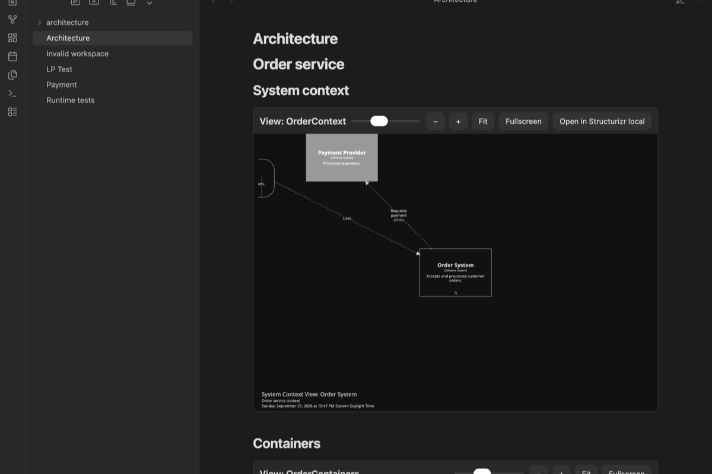
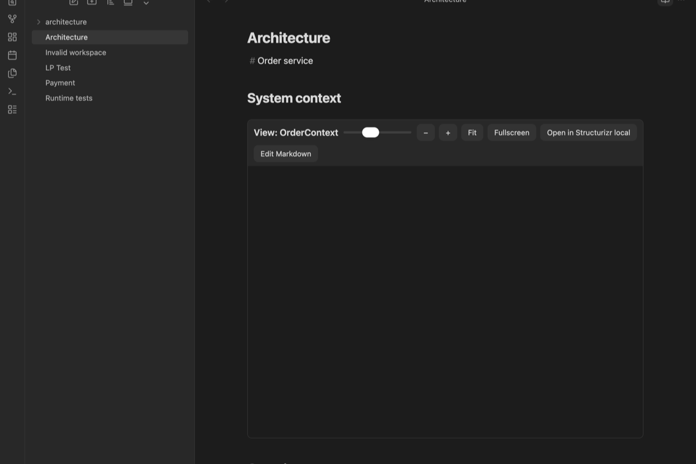

# Structurizr Diagrams for Obsidian

This desktop plugin embeds interactive Structurizr views in Markdown notes. It reads workspaces and exports diagrams on your computer. It does not send notes or workspace data to a public service.



## Install

### Community plugins

After the plugin appears in the Community plugins directory:

1. In Obsidian, open **Settings → Community plugins → Browse**.
2. Search for **Structurizr Diagrams**. Select **Install**, then **Enable**.
3. Install the Structurizr CLI and Graphviz. Graphviz supplies automatic layout for DSL views that use `autoLayout`.
4. Set **Default workspace** to a vault-relative `.dsl` or `.json` file.

### Manual install

1. Download `main.js`, `manifest.json`, and `styles.css` from the [latest release](https://github.com/okdas/obsidian-structurizr/releases/latest).
2. Copy the files into `<vault>/.obsidian/plugins/structurizr-diagrams/`.
3. Enable **Structurizr Diagrams** in Obsidian's Community plugins settings.
4. Install the Structurizr CLI and Graphviz. Set **Default workspace** in plugin settings.

### Build from source

Run `npm ci`, `npm test`, and `npm run build:release`. Copy the `installable/structurizr-diagrams` folder into the vault plugins folder. The release build also creates `installable/structurizr-diagrams.zip`. The plugin requires desktop Obsidian because it starts a local Node.js HTTP server and runs the Structurizr CLI.

## Select a workspace

Set **Default workspace** in plugin settings for notes without a workspace property. The path can point to a `.dsl` or `.json` workspace file inside the vault.

A note can select another workspace with either `structurizr-workspace` or `structurizrWorkspace`.

```yaml
---
structurizr-workspace: architecture/payments/workspace.dsl
---
```

When both files exist beside the selected DSL file, the plugin uses the matching `.json` file for manual positions. If the DSL differs from the DSL saved inside that JSON file, the plugin exports the current DSL and reapplies saved positions and relationship vertices by element ID. New elements can need manual placement. Set **Structurizr CLI command** if the executable is not named `structurizr`. Set **Structurizr local URL** for the local workspace URL used by the open-view control.

## Add diagrams to a note

Use the existing Structurizr Markdown image syntax. The key identifies a view in the selected workspace.

```md
## System context


## Request flow

```

A note can contain multiple embeds. The plugin replaces these embeds in Reading view and Live Preview. In Live Preview, click **Edit Markdown** to edit the source line. Other Markdown remains editable. The diagram key stays in the note and remains visible in Git.



Each diagram has a height slider, zoom-in and zoom-out buttons, a fit-to-content button, a fullscreen control, and an action to open the view in Structurizr local. Use the tooltips and navigation controls inside the frame. Keyboard users can tab to the toolbar and diagram iframe. The static export supports double-click navigation between related views.

## Local operation and refresh

The plugin runs `structurizr-cli export -workspace <workspace> -format static -output <temporary-folder>` when a diagram first loads. Set **Structurizr CLI command** if your installation uses another executable name. A local HTTP server binds only to `127.0.0.1` on an available port. The exporter and viewer run on the same computer as Obsidian.

The plugin watches the DSL and matching JSON file for changes. It re-exports changed workspaces and reloads their open diagrams. Use **Refresh Structurizr diagrams** from the command palette to request a refresh. Export files live in the plugin's generated folder and the plugin deletes that folder when it stops. The `.gitignore` excludes generated files.

The static export keeps zoom and scrolling, the diagram key, tooltips, perspectives, animation, descriptions, metadata, and quick navigation. Structurizr documents that static export removes documentation and decision records. Manual layouts require the workspace JSON file. Structurizr local itself does not support iframe or image embeds.

The static export normally contacts `static.structurizr.com` to load optional themes. The plugin removes that remote theme loader from its temporary copy before serving the page. Built-in light and dark themes remain available. This keeps workspace data on the computer and prevents public theme requests.

## Example vault

Open `example-vault` as a vault to see two primary notes, two workspaces, multiple embeds, a note-level workspace property, and linked context, container, and dynamic views. The order workspace includes `workspace.json` with manual coordinates. Set `architecture/order/workspace.dsl` as the default workspace.

## Known limits

- The plugin needs the Structurizr CLI. It reports a missing workspace, an unknown view key, invalid JSON, or a failed export in the note.
- The plugin reports unknown DSL syntax through the CLI export error. Structurizr CLI versions can vary in command availability and output.
- The Structurizr local open action uses the configured local URL and the view key. Local URL routing can differ between Structurizr versions.
- Obsidian's built-in Markdown post processor serves Reading view. The plugin uses a CodeMirror 6 decoration widget for Live Preview.
- A Git comparison viewer is not implemented. A future viewer can use `git archive` to extract a selected revision's workspace directory into a temporary folder. That copy preserves relative includes and manual-layout JSON without changing the working tree. This checkout has no `.git` metadata, so revision loading could not be tested.

## Validation status

The plugin was tested in Obsidian desktop 1.13.7 with Structurizr CLI 2025.11.09 and Graphviz 16.1.0. Reading view and Live Preview rendered three interactive diagrams in one note. Live Preview kept the Markdown source editable. Tests covered a manual-layout JSON workspace, another note-level workspace, a missing key, invalid DSL, and refresh after DSL and JSON changes. DSL edits kept saved positions for existing elements. `npm test` passed all four CLI export tests. Screenshots in `evidence/` show the note in dark and light themes.
